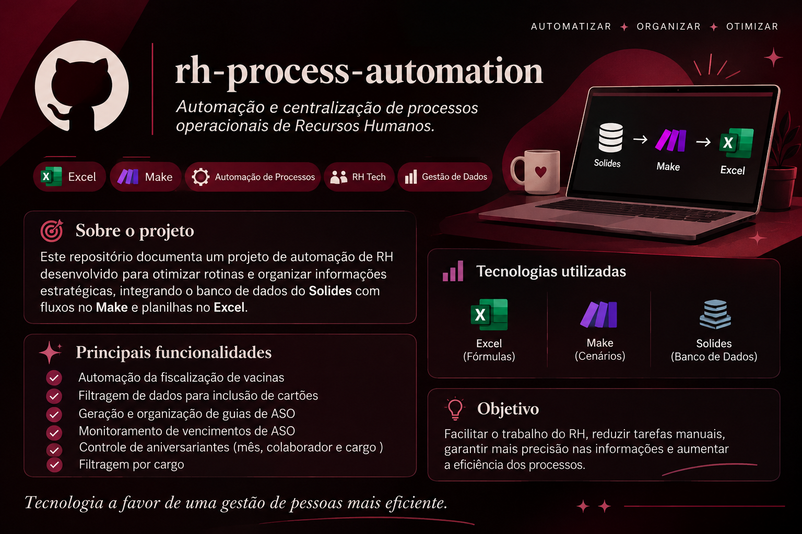

# RH Process Automation



Automação e centralização de processos operacionais de Recursos Humanos utilizando integração de sistemas, Make e Google Sheets.

## Sobre o projeto

Este projeto consiste no desenvolvimento de uma solução para otimizar rotinas administrativas de Recursos Humanos, centralizando informações de colaboradores e automatizando processos operacionais.

A solução utiliza integração de dados, fluxos automatizados e funcionalidades do Google Sheets para facilitar o acompanhamento, a organização e a consulta de informações.

## Objetivos

- Reduzir atividades manuais e repetitivas.
- Centralizar informações dos colaboradores.
- Otimizar processos operacionais de RH.
- Facilitar o monitoramento de pendências e vencimentos.
- Melhorar a organização e a eficiência das rotinas administrativas.

## Tecnologias utilizadas

| Tecnologia    | Aplicação                                         |
| ------------- | ------------------------------------------------- |
| Solides       | Fonte de dados dos colaboradores                  |
| Make          | Integração e automação de fluxos                  |
| Google Sheets | Centralização, organização e tratamento dos dados |

## Processos contemplados

- Controle e fiscalização de vacinação.
- Filtragem de dados para inclusão de cartões de benefícios.
- Geração automática das guias de ASO e salva como PDF. Contemplendo condicionais como: exames específicos para determinada área, idade e setor.
- Monitoramento de vencimentos de ASO.
- Identificação de aniversariantes.
- Consulta e filtragem de colaboradores por cargo.

## Arquitetura da solução

Solides → Make → Google Sheets → Processos de RH

## Estrutura do projeto

```text
rh-process-automation/
├── docs/
├── automations/
│   ├── make/
│   └── google-sheets/
├── screenshots/
├── examples/
└── README.md
```

## Segurança e privacidade

Exemplos utilizados na documentação serão fictícios e destinados exclusivamente à demonstração da solução.

## Status do projeto

Em desenvolvimento.

---

Desenvolvido como projeto de automação de processos empresariais.
